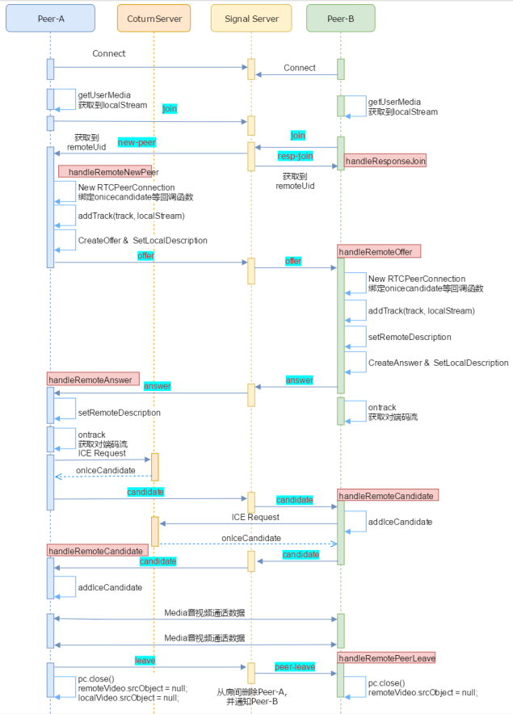

# 信令交互过程
- 蓝底: 信令内容, 红底: 实现的回调
- 注意项: onTrack 获取对端码流, 只是句柄 真实流需要等网络协商



# 信令设计
```js
// join 加入房间  
let jsonMsg = { 
  'cmd': 'join',
  'roomId': roomId, 
  'uid': localUserId,
};

// resp-join 当 join 房间后发现房间已经存在另一个人时则返回另一个人的 uid
//           如果只有自己则不返回
let respJoinMsg = {
  'cmd': 'resp‐join',
  'remoteUid': remoteUid
};

// new-peer 服务器通知客户端有新人加入, 收到 new-peer 则发起连接请求
let newPeerMsg = {
  'cmd': 'new‐peer',
  'remoteUid': uid
};

// leave 离开房间
//       服务器收到 leave 信令则检查同一房间是否有其他人, 如果有其他人则通知他有人离开 
let leaveMsg = { 
  'cmd': 'leave',
  'roomId': roomId, 
  'uid': localUserId,
};

// peer-leave 服务器通知客户端有人离开
let peerLeaveMsg = {
  'cmd': 'peer‐leave',
  'remoteUid': uid
};

// offer 转发 offer sdp
let offerMsg = { 
  'cmd': 'offer',
  'roomId': roomId,
  'uid': localUserId, 
  'remoteUid':remoteUserId,
  'msg': JSON.stringify(sessionDescription)
};

// answer 转发 answer sdp
let answerMsg = { 
  'cmd': 'answer',
  'roomId': roomId,
  'uid': localUserId, 
  'remoteUid':remoteUserId,
  'msg': JSON.stringify(sessionDescription)
};

// candidate 转发 candidate sdp
let candidateMsg = {
  'cmd': 'candidate',
  'roomId': roomId,
  'uid': localUserId, 
  'remoteUid':remoteUserId,
  'msg': JSON.stringify(candidateJson) 
};
```

# 通用接口
## 媒体协商
- 获取浏览器支持的媒体信息 `aPromise = pc.createOffer([options]);`
```js
let options = {     
  offerToReceiveAudio: true,     // 告诉另一端, 你是否想接收音频, 默认 true
  offerToReceiveVideo: true,     // 告诉另一端, 你是否想接收视频, 默认 true 
  iceRestart: false,             // 是否在活跃状态重启 ICE 网络协商, 只有在处于活跃的时候才有作用
  // https://webrtc.github.io/samples/src/content/peerconnection/restart-ice/ 
};
```

- 创建 SDP 应答 `aPromise =pc.createAnswer([options]);` 此处 options 可省略
- 设置本地 SDP `aPromise = pc.setLocalDescription(sessionDescription);`
- 创建远程 SDP `aPromise = pc.setRemoteDescription(sessionDescription);`

## 加入 Stream/Track
- `rtpSender = pc.addTrack(track, stream ...);`
  - track: 添加到 RTCPeerConnection 中的媒体轨(音频track/视频track)
  - stream: getUserMedia 中拿到的流, 指定 track 所在的 stream

## 网络协商
- 加入候选 `aPromise = pc.addIceCandidate(candidate);`
  - 两两查询, 遍历匹配
  - 最终决定打洞或走中继
```js 
// candidate 候选者描述信息
let candidate = {
  sdpMid: "",            // 与候选者相关的媒体流的识别标签
  sdpMLineIndex: "",     // 在 SDP 中 m=的索引值 
  usernameFragment: "",  // 包括了远端的唯一标识
}
```

## RTCPeerConnection 构造
- `pc = new RTCPeerConnection([configuration]);` configuration 属性配置如下
- bundlePolicy: 一般用 max-bundle 
  - banlanced: 音频与视频轨使用各自的传输通道
  - max-compat: 每个轨使用自己的传输通道 
  - max-bundle: 都绑定到同一个传输通道
- iceTransportPolicy: 指定ICE的传输策略, 一般用 all
  - relay: 只使用中继候选者 
  - all: 可以使用任何类型的候选者
- iceServers: 其由 RTCIceServer 组成, 每个 RTCIceServer 都是一个 ICE 代理的服务器
  - credential 凭据, 只有 TURN 服务使用 
  - credentialType 凭据类型, 可以 password 或 oauth 
  - username 用户名, 只有 TURN 服务使用
  - urls 用于连接服中的 url 数组
- rtcpMuxPolicy: 一般用 require
  - rtcp 的复用策略, 该选项在收集 ICE 候选者时使用
  - negotiate 收集 RTCP 与 RTP 复用的 ICE 候选者, 如果 RTCP 能复用就与 RTP 复用, 如果不能复用, 就将他们单独使用
  - require 只能收集 RTCP 与 RTP 复用的 ICE 候选者, 如果 RTCP 不能复用则失败

## 重要事件
- onIceCandidate: 收到候选者时触发的事件
- onTrack: 获取远端流事件
- onConnectionStateChange: PeerConnection 的连接状态
  - 参考: `https://developer.mozilla.org/en-US/docs/Web/API/RTCPeerConnection/connectionState`
- onIceConnectionStatechange: Ice 连接事件 
  - 参考: `https://developer.mozilla.org/en-US/docs/Web/API/RTCPeerConnection/iceConnectionState`
- 举例 
```js
pc.onconnectionstatechange = function(event) {
  switch(pc.connectionState) {
    case "connected":
      // The connection has become fully connected
      break;
    case "disconnected": 
    case "failed":
      // One or more transports has terminated unexpectedly or in an error 
      break;
    case "closed":
      // The connection has been closed
      break;
  }
}
```

# 开发步骤
## 客户端显示界面
## 打开摄像头并显示到页面
## websocket连接 
## join, new-peer, resp-join 信令实现 
## leave、peer-leave信令实现 
## offer、answer、candidate信令实现 
 1）收到new-peer （handleRemoteNewPeer处理），作为发起者创建RTCPeerConnection，绑定事件响应函数， 加入本地流；
（2）创建offer sdp，设置本地sdp，并将offer sdp发送到服务器；
（3）服务器收到offer sdp 转发给指定的remoteClient；
（4）接收者收到offer，也创建RTCPeerConnection，绑定事件响应函数，加入本地流；
（5）接收者设置远程sdp，并创建answer sdp，然后设置本地sdp并将answer sdp发送到服务器；
（6）服务器收到answer sdp 转发给指定的remoteClient；
（7）发起者收到answer sdp，则设置远程sdp；
（8）发起者和接收者都收到ontrack回调事件，获取到对方码流的对象句柄；
（9）发起者和接收者都开始请求打洞，通过onIceCandidate获取到打洞信息（candidate）并发送给对方
（10）如果P2P能成功则进行P2P通话，如果P2P不成功则进行中继转发通话。

- 综合调试和完善
- `sudo sar -n DEV 1`