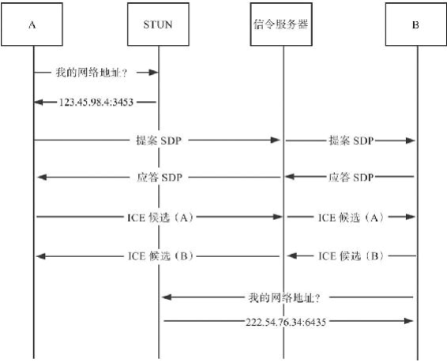
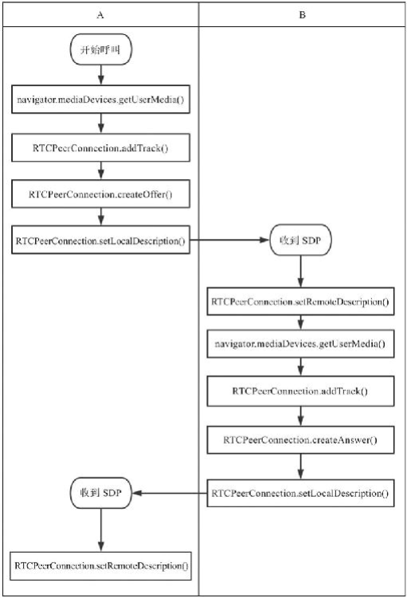

# WebRTC 建立连接过程
## 媒体协商
- 用户 A 向用户 B 发起 WebRTC 呼叫
  - A 首先创建自己的会话描述信息(SDP), 我们称之为提案(offer)
  - A 通过信令服务器将会话描述发送给 B
  - B 同样创建自己的会话描述信息, 我们称之为应答(answer)
  - B 通过信令服务器将其发送给 A
- 这个交换过程由 ICE 控制, 即使是在复杂的网络环境下, ICE 也能确保会话描述交换顺利完成
  - 现在 A 和 B 都拥有了自己和对方的会话描述信息, 在媒体交换格式方面达成了一致, 连接成功, 接下来就可以传输媒体数据了
  - 当会话环境发生变化(比如网络切换、更改编码格式等)时, 以上过程还需要重新来过, 称作 ICE 重新协商 或 ICE 重启



## 调用 API 过程
- A 作为呼叫方, 先获取本地媒体流, 再调用 addTrack() 方法将媒体流加入 RTCPeerConnection 中
  - 这样做是为了随后调用 createOffer() 方法创建本地会话描述时能够包含媒体信息
  - 如果会话描述里没有媒体信息, 通常网络连接可以正常建立, 但是无法交换媒体流, 不能进行音视频通话
  - 在建立网络连接后再调用 addTrack() 方法添加媒体轨道, 则需要重新协商
- A 调用 createOffer()方法创建提案
- A 调用 setLocalDescription() 方法将提案设置为本地会话描述并传递给 ICE 层
  - A 也可以不调用 createOffer() 方法, setLocalDescription()方法如果不带参数, 会默认调用 createOffer() 方法
- A 从 localDescription 属性获取刚刚创建的会话描述信息, 并通过信令服务器发送给 B
- B 作为被呼叫方, 从信令服务器收到 A 发送过来的会话描述信息
- B 判断这是对等端的提案, 调用setRemoteDescription()方法将提案传递给ICE层
- 与 A 的流程相似, B 获取媒体流, 调用 addTrack() 方法加入 RTCPeerConnection
- B 调用 createAnswer()方法创建应答, 调用 setLocalDescription() 方法将应答设置为本地会话描述并传递给 ICE 层
- B 从 localDescription 属性获取刚刚创建的会话描述信息, 并通过信令服务器发送给 A



## RTCSessionDescription

# RTCPeerConnection 接口

# 完美协商模式

# 实战项目
```js
let username = {
  name: myUsername,
  date: Date.now(),
  id: clientID,
  type: "username"
}
```


ClientID  <- connect
          -> userName
```