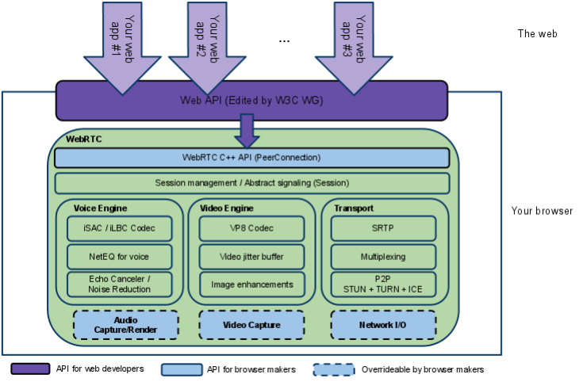
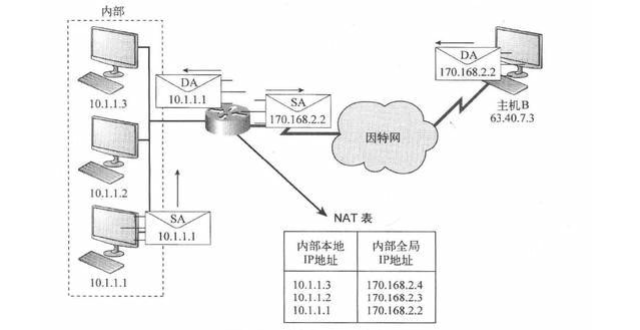
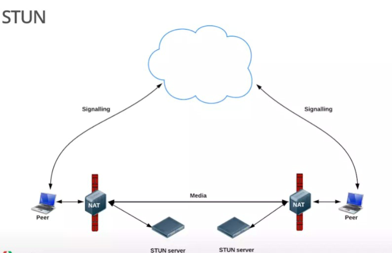
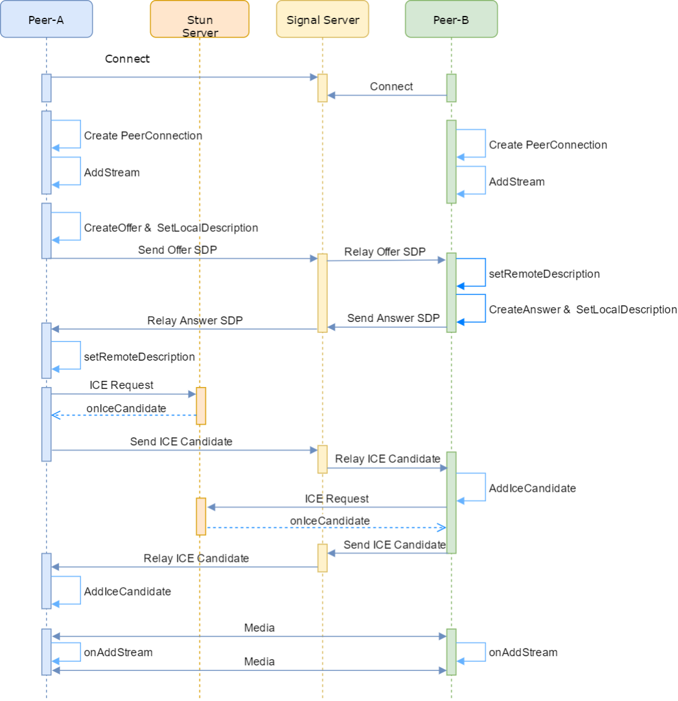

# 1.0 WebRTC 课程介绍
- P2P COTURN 中继服务器
- 建议局域网中采用 relay 模式，及时暴露连接问题
- `iceTransportPolicy: "relay"`

# 1.1 什么是 WebRTC
- WebRTC(Web Real Time Communication)是 Google 于 2010 从 Global IP Solutions 公司购买, 并于 2011 年将其开源
- 旨在建立一个互联网浏览器间的实时通信的平台, 让 WebRTC 技术成为 H5 标准之一, 它通过简单的 API 为浏览器和移动应用程序提供实时通信(RTC)功能

# 1.2 WebRTC 框架
## 结构图

- 紫色部分是Web应用开发者 API 层 
- 蓝色实线部分是面向浏览器厂商的 API 层 
- 蓝色虚线部分浏览器厂商可以自定义实现
- PeerConnection 为 Web 开发人员提供了一个抽象, 从复杂的内部结构中抽象出来
- 我们只需要关注 PeerConnection这个对象即可以开发音视频通话应用内

## 结构介绍
- Your Web App 
  - Web 开发者开发的程序，Web开发者可以基于集成WebRTC的浏览器提供的web API开发基于视频、音频的实时通信应用。
- Web API 
  - 面向第三方开发者的WebRTC标准API（Javascript），使开发者能够容易地开发出类似于网络视频聊天的web应用， 
  - 最新的标准化进程可以查看这里。
- WebRTC Native C++ API
  - 本地C++ API层，使浏览器厂商容易实现WebRTC标准的Web API，抽象地对数字信号过程进行处理。
- Transport / Session 传输/会话层 
  - 会话层组件采用了libjingle库的部分组件实现，无须使用xmpp/jingle协议
- VoiceEngine 音频引擎是包含一系列音频多媒体处理的框架。 (VoiceEngine 是WebRTC极具价值的技术之一, 在VoIP上技术业界领先)
  - Opus：支持从6 kbit/s到510 kbit/s的恒定和可变比特率编码，帧大小从2.5 ms到60 ms，各种采样率从8 kHz（4 kHz 带宽）到48 kHz（20 kHz带宽，可复制人类听觉系统的整个听力范围）。由IETF RFC 6176定义。 
  - NetEQ 模块是 WebRTC 语音引擎中的核心模块, 一种动态抖动缓冲和错误隐藏算法，用于隐藏网络抖动和数据包丢失的负面影响
  - 保持尽可能低的延迟，同时保持最高的语音质量
- VideoEngine WebRTC 视频处理引擎 
  - VideoEngine 是包含一系列视频处理的整体框架, 从摄像头采集视频到视频信息网络传输再到视频显示整个完整过程的解决方案
- VP8 视频图像编解码器, 是 WebRTC 视频引擎的默认的编解码器 
  - VP8 适合实时通信应用场景, 因为它主要是针对低延时而设计的编解码器

# 1.3 Web
- WebRTC虽然冠以 'web' 之名, 但并不受限于传统互联网应用或浏览器的终端运行环境。
- 实际上无论终端运行环境是浏览器、桌面应用、移动设备（Android或iOS）还是IoT设备，只要IP连接可到达且符合WebRTC规范就可以互通。
- 这一点释放了大量智能终端（或运行在智能终端上的app）的实时通信能力，打开了许多对于实时交互性要求较高的应用场景的想象空间，
- 譬如在线教育、视频会议、视频社交、远程协助、远程操控等等都是其合适的应用领域。

- 直播 RTMP 多级服务器 CDN 单向分发 
- WebRTC 中间服务器 双向传播 (最多 17 人 带宽要求)

# 1.4 相关厂商
- 基于 WebRTC 二次开发音视频通话方案
  - 声网
  - 即构科技
  - 环信
  - 融云

# 1.5 WebRTC 通话原理
## 媒体协商
- Peer A: VP8, H264 编码
- PeerB: VP9, H264 编码
- 要保证二端都采用正确编解码, 最简单的办法就是取它们的交集 H264 编码
- Session Description Protocol(SDP): 用于描述上述这类信息
- WebRTC 中, 参与视频通讯的双方必须先交换 SDP 信息, 这样双方才能知根知底, 而交换SDP的过程, 也称为媒体协商

## 网络协商 
- 彼此要了解对方的网络情况, 这样才有可能找到一条相互通讯的链路
  - (1) 获取外网IP地址映射
  - (2) 通过信令服务器(Signal Server) 交换网络信息
- 网络相关
  - 理想的网络情况: 每个浏览器的电脑都是 私有公网 IP, 可以直接进行点对点连接
  - 实际的网络情况: 大部分电脑是在某个局域网中, 需要NAT (Network Address Translation, 网络地址转换)

## NAT
- SA 10.1.1.1 -> NAT -> SA: 170.168.2.2:60 通过转换表, 绑定端口 60, 发送给主机 B 
- DS 170.168.2.2:60 -> NAT -> DS: 10.1.1.1 通过转化表, 查找到内部地址, 发送给 10.1.1.1 主机

## STUN
- Session Traversal Utilities for NAT, NAT 会话穿越应用程序, 一种网络协议
  - 允许位于 NAT(或多重 NAT)后的客户端找出自己的公网地址, 查出自己位于哪种类型的 NAT 之后以及 NAT 为某一个本地端口所绑定的 Internet 端端口
  - 这些信息被用来在两个同时处于NAT路由器之后的主机之间创建 UDP 通信
  - 该协议由 RFC 5389 定义
- STUN 服务器
  - 主要是给无法在公网环境下的视频通话设备分配公网 IP 用的, 这样两台电脑就可以在公网 IP 中进行通话
  - 使用一句话说明 STUN 做的事情就是: 告诉我你的公网 IP 地址 + 端口是什么
- STUN 服务器的缺点
  - 对称 NAT, 对于同一个内部地址, 每当它向不同的外部目标(IP 或端口)发送数据时, NAT 都会分配一个全新的、不同的外部端口, 此时 STUN 失效
  - P2P 通话(Mesh 拓扑) 中每个参与者都需要直接向其他所有参与者发送自己的视频流, 上行带宽消耗会随人数线性增长, 无法支撑多人会议

## TURN 
- Traversal Using Relays around NAT, 是 STUN/RFC5389 的一个拓展协议, 主要添加了Relay功能
  - STUN 分配公网IP失败后, 采用公网的服务器作为一个中继, 对来往的数据进行转发
- TURN 服务器优点
  - 带宽从本地转移到服务器端, 在多人视频聊天的时候, 本地带宽压力较小
  - TURN 协议可以使用在所有的环境中 
- TURN 服务器缺点 
  - 按照单向数据 200kbps 为一对一通话标准, 一对连接需要 200kbps * 4 贷款
- 开源项目
  - coturn 开源项目集成了 STUN 和 TURN 的功能
  - ICE(Interactive Connectivity Establishment, 交互式连接建立) 
    - ICE 不是一种协议, 而是一个框架
    - 包含了收集地址(调用 STUN/TURN), 交换地址(通过信令), 连通性检查(发Ping打洞), 最终建立连接的一整套完整机制
- 术语
  - WebRTC 媒体协商: SDP 编解码类型
  - WebRTC 网络协商: Candidate 描述网络信息

## 信令服务器
- Signal Server, 信令服务器, 为两端转发媒体信息和网络信息
  - 信令服务器一般搭建在公网, 或者两端都可以访问到的局域网
  - 信令服务器不只是交互 SDP 和网络信息 Candidate, 比如
    - 房间管理 
    - 人员进出房间
- WebRTC APIs
  - MediaStream 表示一个媒体数据流(通过 getUserMedia 接口获取), 允许你访问输入设备, 如麦克风和 Web摄像机, 从其中任意一个获取媒体流
  - RTCPeerConnection 该对象允许用户在两个浏览器之间直接通讯 
    - 可以通过网络将捕获的音频和视频流实时发送到另一个 WebRTC 端点
    - 使用这些 API, 可以在本地机器和远程对等点之间创建连接
    - 它提供了连接到远程对等点, 维护和监视连接以及在不再需要连接时关闭连接的方法

## 一对一通话过程
- 第一阶段: 连接与初始化
  - Peer-A 和 Peer-B 分别与 Signal Server 建立 WebSocket 长连接, 准备进行 Candidate 交换
  - Peer-A 和 Peer-B 分别在本地创建 RTCPeerConnection 对象, 这是 WebRTC 的核心
  - Peer-A 和 Peer-B 分别获取本地摄像头/麦克风的媒体流(MediaStream)并添加到各自 RTCPeerConnection 中, 准备发送
- 第二阶段: SDP 协商(媒体能力交换)
  - 发起方(Peer-A) 生成一个 SDP Offer, 其中包含了本地的媒体能力(如支持的编解码器, 分辨率等), 并将其设置为本地描述 
  - Peer-A 将生成的 SDP Offer 通过信令服务器发送给 Peer-B, 信令服务器只负责转发, 不解析内容
  - Peer-B 收到 Offer 后, 将其设置为远端描述, 从而了解 Peer-A 的媒体能力
  - Peer-B 根据 Peer-A 的 Offer 生成一个 Answer(SDP), 表示自己接受的能力范围, 并将其设置为本地描述
  - Peer-B 将 Answer 通过信令服务器发回给 Peer-A
  - Peer-A 收到 Answer 后, 将其设置为远端描述
  - 至此, 双方对媒体格式达成一致
- 第三阶段: ICE 候选收集与交换(网络穿透)
  - 双方分别向 STUN 服务器发送请求, 获取自己的公网 IP 和端口, 每发现一个可用的网络路径(候选地址), 就会触发 oniceCandidate 事件
  - 双方将收集到的 ICE 候选地址通过信令服务器互相交换
  - 每一方收到对方的 ICE 候选后, 调用 addIceCandidate() 将其添加到本地连接中, 供 ICE 层进行连通性检查
- 第四阶段: 媒体传输
  - 当双方互相添加了对方的 ICE 候选后, WebRTC 的 ICE 层会进行连通性检查
  - 一旦找到可连通的路径(打洞成功), 媒体流就会脱离服务器, 直接在 Peer-A 和 Peer-B 之间进行 P2P 传输 
  - 当对方的媒体流到达时, 会触发相应事件 onAddStream
  - 如果打洞失败, 则会借用 TURN 服务器 转发双方媒体流实现 P2P 

## NAT 补充
- P2P技术详解(一)：NAT详解——详细原理、P2P简介 https://www.cnblogs.com/mlgjb/p/8243646.htm 
- P2P技术详解(二)：P2P中的NAT穿越(打洞)方案详解 https://www.jianshu.com/p/9bfbcbee0abb 
- P2P技术详解(三)：P2P技术之STUN、TURN、ICE详解 https://www.jianshu.com/p/258e7d8be2ba
- 详解P2P技术中的NAT穿透原理 https://www.jianshu.com/p/f71707892eb2