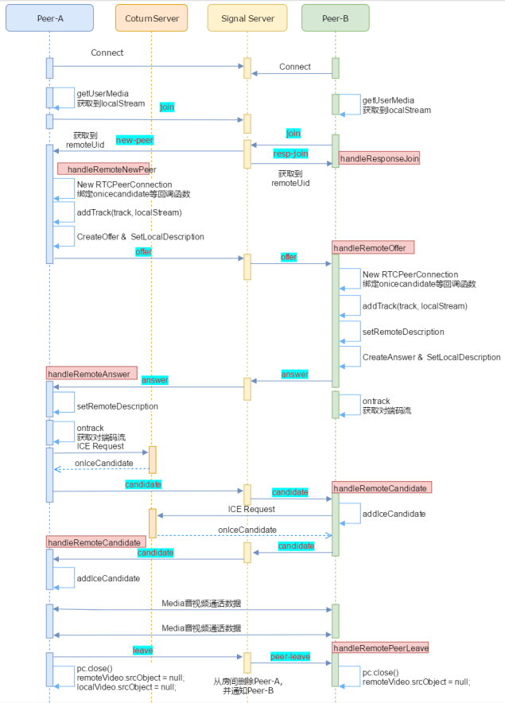

- RTCPeerConnection
- 步骤
  1. 信令设计
  2. 媒体协商
  3. 加入Stream/Track
  4. 网络协商
- CreateOffer 获取浏览器支持媒体信息
- onTrack 获取对端码流, 只是句柄 真实流需要等网络协商
- addCandidate 后 两两查询, 遍历匹配, 最后打洞或走中继

1. join 加入房间 
2. resp-join 当join房间后发现房间已经存在另一个人时则返回另一个人的uid；如果只有自己则不返回
3. leave 离开房间，服务器收到 leave 信令则检查同一房间是否有其他人，如果有其他人则通知他有人离开 
4. new-peer 服务器通知客户端有新人加入，收到 new-peer 则发起连接请求
5. peer-leave 服务器通知客户端有人离开
6. offer 转发 offer sdp
7. answer 转发 answer sdp
8. candidate 转发 candidate sdp